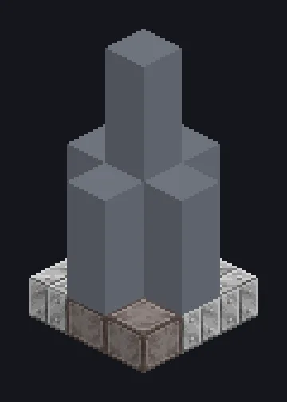

---
tags:
  - Electric processing
---

# Infinity Fluid Drilling Rig

<!-- Generated from the mod code; the structure shown is the smallest variant. -->

*Better than Minecraft's infinite water. Barely legal.*

{ loading=lazy }

| | |
|---|---|
| **Machine type** | Fluid Drilling |
| **Category** | Electric processing |
| **Recipe types** | None |
| **Size** | 3 × 7 × 3 |
| **Blocks** | 27 |
| **Origin** | GregTech Odyssey |

## Description

Drills fluids from self-regenerating veins under the bedrock.

- Vein depletion rate: 0
- Output: 256x at ZPM, 384x at UV
- Needs a ZPM or better energy supply

## Structure

| Block | Qty |
|---|---:|
| Ruridit Frame | 15 |
| Iridium Casing | 9 |
| Infinity Fluid Drilling Rig | 1 |
| ULV Output Hatch | 1 |
| ULV Energy Hatch | 1 |

<small>Generated from the mod code; the structure shown is the smallest variant.</small>
