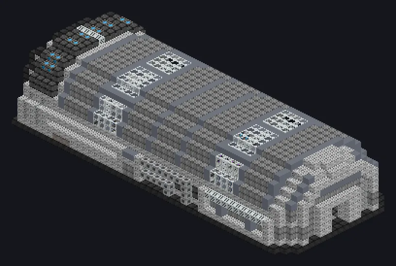

---
tags:
  - Catálogo de multiblocos
---

# Montadora Integrada

<!-- Página gerada a partir do código do mod; a estrutura é a menor variante. -->

{ loading=lazy }

| | |
|---|---|
| **Tipos de receita** | Assembler |
| **Tamanho** | 48 × 13 × 19 |
| **Blocos** | 4.704 |

## Descrição

Torne o complexo simples e o impossível rotina. Uma linha de montagem hiperespacial que constrói de chips a motores.

- Tipo de Máquina: Montadora
- Thread Hatch: várias receitas ao mesmo tempo
- Aceita Laser Hatches
- Paralelos definidos pelo Parallel Hatch

## Estrutura

| Bloco | Qtd. |
|---|---:|
| Carcaça de Irídio | 1.314 |
| Casing Mecanico de Hastelloy N Resistente a Oxidacao | 1.073 |
| Invólucro de Liga de Naquadah | 459 |
| Nonconducting Casing | 428 |
| Filter Casing | 329 |
| Hsla Steel Frame | 301 |
| Cleanroom Glass | 256 |
| Stainless Steel Frame | 198 |
| Caixa de Engrenagens de Amprósio | 79 |
| Carcaça de Tubo de Amprósio | 64 |
| White Lamp | 40 |
| Unidade de Montagem Espaço-Temporal | 37 |
| Unidade Avançada de Linha de Montagem | 32 |
| Iron Bars | 26 |
| Hermetic Casing IX | 24 |
| Assembly Control Casing | 24 |
| Carcaça da Linha de Montagem de Circuitos | 12 |
| Casing de Maquina de Processo | 2 |
| Cleaning Maintenance Hatch | 1 |
| ULV Energy Hatch | 1 |
| ULV Output Bus | 1 |
| ULV Input Bus | 1 |
| ULV Input Hatch | 1 |
| Montadora Integrada | 1 |

<small>Página gerada a partir do código do mod; a estrutura é a menor variante.</small>
