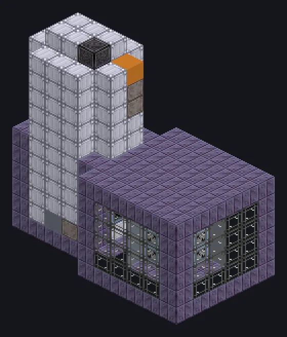

---
tags:
  - Catálogo de multiblocos
---

# Processador de Minério Integrado

<!-- Página gerada a partir do código do mod; a estrutura é a menor variante. -->

{ loading=lazy }

| | |
|---|---|
| **Tipos de receita** | Processamento Integrado de Minério |
| **Tamanho** | 11 × 12 × 6 |
| **Blocos** | 344 |

## Descrição

A linha inteira de processamento de minério, numa caixa. Processamento de minério completo num passo; o circuito escolhe uma de sete rotas.

- Tipo de Máquina: Processamento Integrado de Minério
- Mói, lava, banha, peneira e centrifuga de uma vez
- Circuito 1: Triturar -> Triturar -> Centrifugar
- Circuito 2: Triturar -> Lavar -> Térmica -> Triturar
- Circuito 3: Triturar -> Lavar -> Triturar -> Centrifugar
- Circuito 4: Triturar -> Lavar -> Peneirar -> Centrifugar
- Circuito 5: Triturar -> Banho -> Térmica -> Triturar
- Circuito 6: Triturar -> Banho -> Triturar -> Centrifugar
- Circuito 7: Triturar -> Banho -> Peneirar -> Centrifugar
- Paralelos vêm dos Parallel Control Hatches

## Estrutura

| Bloco | Qtd. |
|---|---:|
| Sturdy HSS-E Machine Casing | 128 |
| Clean Stainless Steel Casing | 93 |
| Laminated Glass | 48 |
| Tungstensteel Pipe Casing | 34 |
| Blue Steel Frame | 16 |
| Tungstensteel Gearbox Casing | 16 |
| ULV Output Bus | 1 |
| Elite Parallel Control Hatch | 1 |
| Cleaning Maintenance Hatch | 1 |
| Processador de Minério Integrado | 1 |
| ULV Energy Hatch | 1 |
| Muffler Hatch ZPM | 1 |
| ULV Input Bus | 1 |
| ULV Input Hatch | 1 |
| ZPM Hatch de Threads | 1 |

<small>Página gerada a partir do código do mod; a estrutura é a menor variante.</small>
