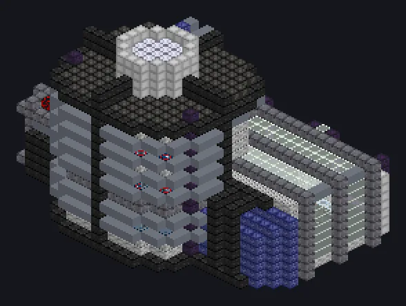

---
tags:
  - Catálogo de multiblocos
---

# Sistema Integrado de Deposição de Vapor

<!-- Página gerada a partir do código do mod; a estrutura é a menor variante. -->

{ loading=lazy }

| | |
|---|---|
| **Tipos de receita** | Deposição Química de Vapor, Deposição Física de Vapor |
| **Tamanho** | 32 × 21 × 25 |
| **Blocos** | 5.020 |

## Descrição

Cresce filmes um átomo por vez. Fábricas pagam bilhões por menos. Deposita filmes finos a partir de gás e vapor para chips e revestimentos.

- Tipo de Máquina: Deposição Química de Vapor, Deposição Física de Vapor
- Paralelos: o maior entre 4^tier do vidro
- e o limite do Parallel Hatch
- Thread Hatch: várias receitas ao mesmo tempo
- Todos os vidros precisam ser do mesmo tier

## Estrutura

| Bloco | Qtd. |
|---|---:|
| Carcaça de Contenção de Pressão | 661 |
| Carcaça de Irídio | 481 |
| Tempered Glass | 371 |
| Carcaça Anticongelante à Prova de Calor | 328 |
| Carcaça SPS | 301 |
| Carcaça Ativa de Amprósio | 279 |
| Naquadah Alloy Frame | 260 |
| Carcaça Estável de Neutrônio | 246 |
| Carcaça de Tratamento de Água de Naquadah Estabilizada | 233 |
| Carcaça de Planta Reforçada com Naquadah | 228 |
| Carcaça de Tubo de Amprósio | 172 |
| Carcaça Mecânica de Lafium | 167 |
| Cubo Mecânico Absorvedor de Raios de Cerâmica de Carbonato de Estrôncio | 167 |
| Palladium Substation Casing | 148 |
| Stainless Steel Frame | 147 |
| Barrier | 124 |
| Gerador de Campo de Contenção | 119 |
| Corrosion Proof Casing | 117 |
| Atomic Casing | 112 |
| Unidade Avançada de Linha de Montagem | 80 |
| Carcaça Hermética UEV | 78 |
| PTFE Pipe Casing | 74 |
| Vidro Quântico | 50 |
| Invólucro Oco | 48 |
| Polytetrafluoroethylene Frame | 22 |
| Sistema Integrado de Deposição de Vapor | 1 |
| ULV Energy Hatch | 1 |
| Cleaning Maintenance Hatch | 1 |
| ULV Input Bus | 1 |
| ULV Output Bus | 1 |
| ULV Input Hatch | 1 |
| ULV Output Hatch | 1 |

<small>Página gerada a partir do código do mod; a estrutura é a menor variante.</small>
