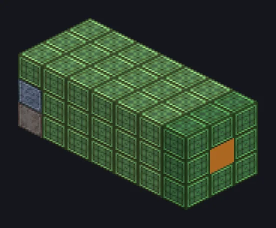

---
tags:
  - 电力加工
---

# 艾萨研磨机

<!-- 根据模组代码生成;所示结构为最小形态。 -->

*虽然刷成绿色，它一点也不环保。*

{ loading=lazy }

| | |
|---|---|
| **机器类型** | 艾萨研磨机 |
| **分类** | 电力加工 |
| **配方类型** | 艾萨研磨机 |
| **尺寸** | 7 × 3 × 3 |
| **方块数** | 63 |
| **来源** | GregTech Odyssey |

## 说明

通过剧烈的球磨将矿石和粗矿湿磨成研磨产物。

- 无损超频：每级耗时/4
- 并行：2
- 皂石：电路1；铝：电路10
- 需要配方等级的研磨球仓
- 每个配方都会磨损研磨球

## 结构

| 方块 | 数量 |
|---|---:|
| 因科镍625外壳 | 42 |
| 因科镍625管道 | 8 |
| 因科镍625齿轮箱 | 5 |
| ULV能源仓 | 1 |
| ULV输入总线 | 1 |
| ULV输入仓 | 1 |
| ULV输出总线 | 1 |
| 超净维护仓 | 1 |
| IV消声仓 | 1 |
| 艾萨研磨机 | 1 |
| 研磨球仓 | 1 |

<small>根据模组代码生成；所示结构为最小形态。</small>
