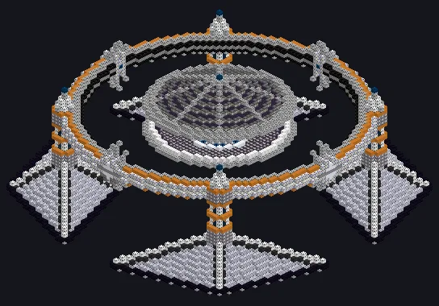

---
tags:
  - Processamento elétrico
---

# Homogeneizador Kerr-Newman

<!-- Gerada a partir do código do mod; a estrutura mostrada é a menor variante. -->

*Um buraco negro carregado e girando. Mexe melhor que qualquer colher.*

{ loading=lazy }

| | |
|---|---|
| **Tipo de máquina** | Misturador |
| **Categoria** | Processamento elétrico |
| **Tipos de receita** | Mixer |
| **Tamanho** | 83 × 36 × 83 |
| **Blocos** | 15.638 |
| **Origem** | GregTech Odyssey |

## Descrição

Mistura na borda de uma singularidade em rotação, várias receitas ao mesmo tempo.

- Thread Hatch: várias receitas ao mesmo tempo
- Aceita Parallel Hatch e hatches de laser

## Estrutura

| Bloco | Qtd. |
|---|---:|
| Invólucro Hipermecânico | 2.220 |
| Carcaça de Contenção de Pressão | 2.016 |
| Carcaça de Irídio | 1.200 |
| Acelerador Blindado | 1.136 |
| Atomic Casing | 896 |
| Bloco Mecanico Ceramico de Zirconia Resistente a Flexao | 668 |
| Invólucro Mecânico Anticorrosão de PPS | 608 |
| Bobina de Fusão Avançada | 566 |
| Eixo de Suporte de Alta Resistência | 544 |
| Carcaça de Fusão MK IV | 528 |
| Invólucro de Injeção Dimensional | 522 |
| Carcaça Mecânica Hyper Reforçada | 512 |
| Carcaça de Bobina de Confinamento Eletromagnético do Acelerador UHV | 512 |
| Carcaça Absorvedora de Radiação | 472 |
| Hastelloy N Frame | 468 |
| Carcaça de Estabilização Gravitacional | 386 |
| Casing de Densidade Extrema | 320 |
| Carcaça de Tubo de Alta Pressão | 288 |
| Naquadah Alloy Frame | 272 |
| Vidro Quântico | 256 |
| Carcaça Mecânica Bioativa | 224 |
| Vidro Industrial sem Moldura | 187 |
| Carcaça de Tubulação Selada de Óleo e Gás | 172 |
| Carcaça de Aquecedor de Plasma | 168 |
| Caixa de Engrenagens de Amprósio | 112 |
| Carcaça Ativa de Amprósio | 104 |
| Invólucro Oco | 102 |
| Tungsten Carbide Frame | 64 |
| Carcaça de Tubo de Amprósio | 56 |
| Trinium Frame | 32 |
| Carcaça de Estrutura Espacial Reforçada | 10 |
| Gerador de Campo de Contenção | 10 |
| ULV Output Hatch | 1 |
| Cleaning Maintenance Hatch | 1 |
| ULV Input Hatch | 1 |
| Homogeneizador Kerr-Newman | 1 |
| ULV Energy Hatch | 1 |
| ULV Output Bus | 1 |
| ULV Input Bus | 1 |

<small>Gerada a partir do código do mod; a estrutura mostrada é a menor variante.</small>
