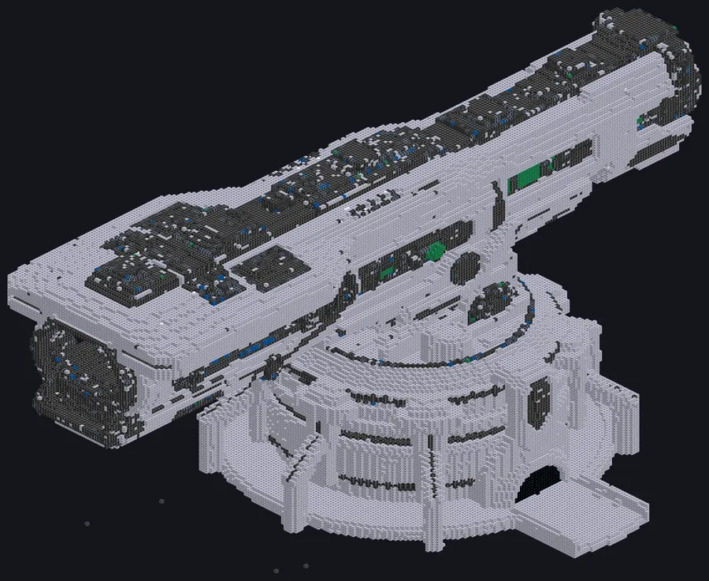

---
tags:
  - Catálogo de multiblocos
---

# Lança Cinética Orbital

<!-- Página gerada a partir do código do mod; a estrutura é a menor variante. -->

{ loading=lazy }

| | |
|---|---|
| **Tipos de receita** | Nenhum |
| **Tamanho** | 142 × 130 × 242 |
| **Blocos** | 171.556 |

## Descrição

Mineração de asteroides, do jeito barulhento. Dispara projéteis contra luas e asteroides com um banco de capacitores e recolhe os fragmentos em cápsulas.

- Tipo de Máquina: Mineração Orbital
- Levante cada corpo para abrir o mapa orbital
- Monte trilhos, refrigeração e sensores na bancada
- Energia do tiro: ½ m v² do banco inteiro
- Regime do impacto: fragmenta, funde, vaporiza
- Cápsulas voltam depois do tempo de viagem
- Revestimento gasto falha o tiro
- Cano quente desvia a mira

## Estrutura

| Bloco | Qtd. |
|---|---:|
| Clean Stainless Steel Casing | 101.576 |
| Carcaça de Liga de Naquadah Radiante | 52.147 |
| Tungstensteel Pipe Casing | 7.963 |
| Chemically Inert PTFE Machine Casing | 7.044 |
| Núcleo de Lançamento Dyson | 803 |
| Heat Vent | 759 |
| Carcaça Estável de Neutrônio | 620 |
| Carcaça Molecular | 418 |
| Carcaça de Aquecedor de Plasma | 172 |
| Solid Machine Casing | 49 |
| Hatch de Revestimento do Cano | 1 |
| Lança Cinética Orbital | 1 |
| Computation Data Reception Hatch | 1 |
| ULV Output Bus | 1 |
| ULV Input Bus | 1 |

<small>Página gerada a partir do código do mod; a estrutura é a menor variante.</small>
