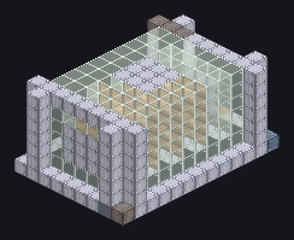

---
tags:
  - 电力加工
---

# 大型裂化机

<!-- 根据模组代码生成;所示结构为最小形态。 -->

*像做周日填字游戏一样裂解烃类。*

{ loading=lazy }

| | |
|---|---|
| **机器类型** | 裂化机 |
| **分类** | 电力加工 |
| **配方类型** | 裂化机 |
| **尺寸** | 9 × 7 × 13 |
| **方块数** | 486 |
| **来源** | GregTech Odyssey |

## 说明

利用加热线圈和并行仓大批量运行裂化机配方。

- 白铜以上每级线圈：EU-10%
- 并行数由并行仓设定
- 永恒线圈时EU降至10%

## 结构

| 方块 | 数量 |
|---|---:|
| 洁净不锈钢机械方块 | 219 |
| 钢化玻璃 | 176 |
| 白铜线圈方块 | 84 |
| ULV输出仓 | 1 |
| ULV输入仓 | 1 |
| ULV输入总线 | 1 |
| 大型裂化机 | 1 |
| 超净维护仓 | 1 |
| IV并行控制仓 | 1 |
| ULV能源仓 | 1 |

<small>根据模组代码生成；所示结构为最小形态。</small>
