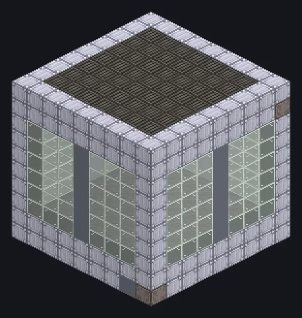

---
tags:
  - Electric processing
---

# Large Greenhouse

<!-- Generated from the mod code; the structure shown is the smallest variant. -->

*Who needs the sun? We have lamps and ambition.*

{ loading=lazy }

| | |
|---|---|
| **Machine type** | Greenhouse, Tree Growth |
| **Category** | Electric processing |
| **Recipe types** | Greenhouse, Tree Growth Simulator |
| **Size** | 9 × 10 × 9 |
| **Blocks** | 516 |
| **Origin** | GregTech Odyssey |

## Description

Grows crops and trees in two selectable recipe modes.

- Works without sunlight
- Accepts a Parallel Hatch
- Pick tree or crop mode at the controller

## Structure

| Block | Qty |
|---|---:|
| Clean Stainless Steel Casing | 194 |
| Tempered Glass | 144 |
| Mud | 49 |
| Assembly Line Grating | 49 |
| Stainless Steel Frame | 37 |
| PTFE Pipe Casing | 36 |
| Large Greenhouse | 1 |
| Elite Parallel Control Hatch | 1 |
| ULV Input Hatch | 1 |
| Cleaning Maintenance Hatch | 1 |
| ULV Output Bus | 1 |
| ULV Energy Hatch | 1 |
| ULV Input Bus | 1 |

<small>Generated from the mod code; the structure shown is the smallest variant.</small>
