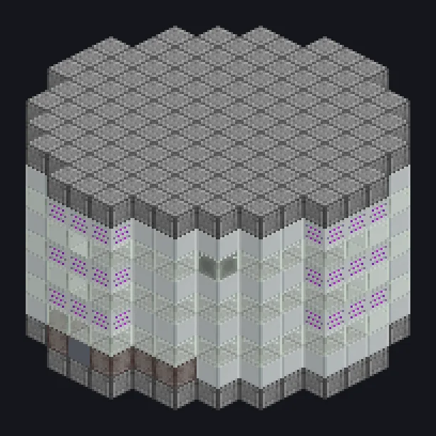

---
tags:
  - Processamento elétrico
---

# Incubadora Grande

<!-- Gerada a partir do código do mod; a estrutura mostrada é a menor variante. -->

*Uma estufa para o que é melhor deixar atrás do vidro.*

{ loading=lazy }

| | |
|---|---|
| **Tipo de máquina** | Incubadora |
| **Categoria** | Processamento elétrico |
| **Tipos de receita** | Incubadora |
| **Tamanho** | 13 × 9 × 13 |
| **Blocos** | 473 |
| **Origem** | GregTech Odyssey |

## Descrição

Cultiva culturas numa câmara selada e filtrada; o vidro decide até onde ela pode ir.

- Aceita Parallel Hatch
- Tier de voltagem limitado pelo tier do vidro
- Receitas podem pedir filtro estéril
- Todos os vidros precisam ser do mesmo tier

## Estrutura

| Bloco | Qtd. |
|---|---:|
| Casing Mecanico de Hastelloy N Resistente a Oxidacao | 242 |
| Tempered Glass | 96 |
| Plascrete | 85 |
| Sterilizing Filter Casing | 36 |
| PTFE Pipe Casing | 7 |
| ULV Output Hatch | 1 |
| ULV Input Bus | 1 |
| Incubadora Grande | 1 |
| Cleaning Maintenance Hatch | 1 |
| ULV Energy Hatch | 1 |
| ULV Input Hatch | 1 |
| ULV Output Bus | 1 |

<small>Gerada a partir do código do mod; a estrutura mostrada é a menor variante.</small>
