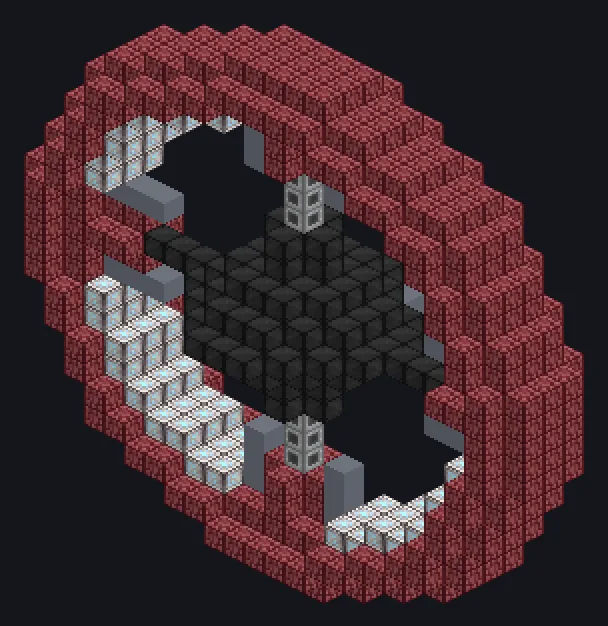

---
tags:
  - 发电
---

# 大型硅岩反应堆

<!-- 根据模组代码生成;所示结构为最小形态。 -->

*进去的是硅岩，出来的是吉瓦。邻居都搬走了。*

{ loading=lazy }

| | |
|---|---|
| **机器类型** | 发电机 |
| **分类** | 发电 |
| **配方类型** | 大型硅岩反应堆 |
| **尺寸** | 25 × 25 × 9 |
| **方块数** | 715 |
| **来源** | GregTech Odyssey |

## 说明

将硅岩燃料与氢气或等离子体一起燃烧，提供稳定的 UHV 电力。

- 可朝任意方向建造
- 动力仓或激光源仓
- 燃料 + 氢气：2,097,152 EU/t
- 燃料 + 等离子体：524,288 EU/t，持续时间为 32 倍
- 最多 3 个流体输入仓

## 结构

| 方块 | 数量 |
|---|---:|
| 极限强度三钛合金机械方块 | 407 |
| 高能机械方块 | 126 |
| 超能机械方块 | 113 |
| 凯金框架 | 24 |
| 安普洛齿轮箱机械方块 | 16 |
| 超能硅岩框架 | 12 |
| 安普洛管道方块 | 12 |
| ULV输入仓 | 2 |
| ULV动力仓 | 1 |
| 大型硅岩反应堆 | 1 |
| 超净维护仓 | 1 |

<small>根据模组代码生成；所示结构为最小形态。</small>
