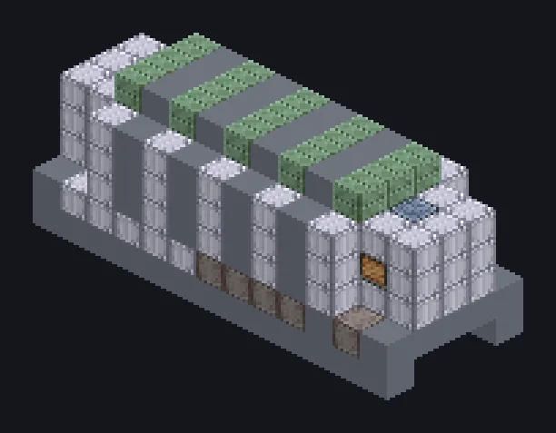

---
tags:
  - Processamento elétrico
---

# Grande Forno de Pirólise

<!-- Gerada a partir do código do mod; a estrutura mostrada é a menor variante. -->

*Madeira entra, química sai, fumaça vai para todo lado.*

{ loading=lazy }

| | |
|---|---|
| **Tipo de máquina** | Forno de Pirólise |
| **Categoria** | Processamento elétrico |
| **Tipos de receita** | Pyrolyse Oven |
| **Tamanho** | 13 × 6 × 5 |
| **Blocos** | 272 |
| **Origem** | GregTech Odyssey |

## Descrição

Roda receitas do Forno de Pirólise em massa com um Parallel Hatch.

- A velocidade cresce com o tier da bobina
- Paralelos definidos pelo Parallel Hatch

## Estrutura

| Bloco | Qtd. |
|---|---:|
| Clean Stainless Steel Casing | 121 |
| Stainless Steel Frame | 48 |
| Ruridit Frame | 36 |
| Heat Proof Invar Machine Casing | 30 |
| Cupronickel Coil Block | 28 |
| Muffler Hatch IV | 2 |
| Grande Forno de Pirólise | 1 |
| ULV Output Hatch | 1 |
| ULV Input Hatch | 1 |
| ULV Output Bus | 1 |
| ULV Input Bus | 1 |
| Cleaning Maintenance Hatch | 1 |
| ULV Energy Hatch | 1 |

<small>Gerada a partir do código do mod; a estrutura mostrada é a menor variante.</small>
