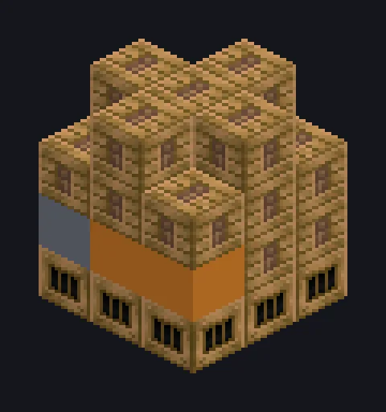

---
tags:
  - Steam and primitive
---

# Large Steam Alloy Smelter

<!-- Generated from the mod code; the structure shown is the smallest variant. -->

*Bronze Age metallurgy, now with industrial ambition.*

{ loading=lazy }

| | |
|---|---|
| **Machine type** | Alloy Smelter |
| **Category** | Steam and primitive |
| **Recipe types** | Alloy Smelter |
| **Size** | 3 × 4 × 3 |
| **Blocks** | 31 |
| **Origin** | GT: Not Leisure |

## Description

A high-pressure steam chamber that fuses metals into alloys by the stack.

- ~1.75x speed vs. singleblock
- High pressure: 2x speed, 2x steam
- Parallel: up to 64

## Structure

| Block | Qty |
|---|---:|
| Steam Machine Casing | 18 |
| Bronze Firebox Casing | 9 |
| Steam Output Bus | 1 |
| Large Steam Alloy Smelter | 1 |
| Steam Input Bus | 1 |
| Wireless Steam Input Hatch | 1 |

<small>Generated from the mod code; the structure shown is the smallest variant.</small>
