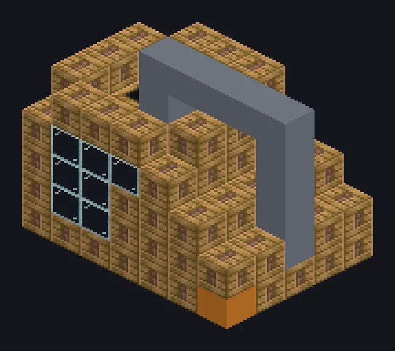

---
tags:
  - Multiblock catalog
---

# Large Steam Bath

<!-- Generated from the mod code; the structure shown is the smallest variant. -->

{ loading=lazy }

| | |
|---|---|
| **Recipe types** | Chemical Bath |
| **Size** | 7 × 6 × 5 |
| **Blocks** | 143 |

## Description

A spa day for ores. No cucumbers provided. A large steam chemical bath for early bulk washing.

- Machine Type: Chemical Bath
- 2x speed vs. singleblock
- High pressure: 2x speed, 2x steam
- Parallel: up to 64

## Structure

| Block | Qty |
|---|---:|
| Steam Machine Casing | 84 |
| Bronze Pipe Casing | 24 |
| Glass | 23 |
| Bronze Frame | 10 |
| Large Steam Bath | 1 |
| Wireless Steam Input Hatch | 1 |

<small>Generated from the mod code; the structure shown is the smallest variant.</small>
