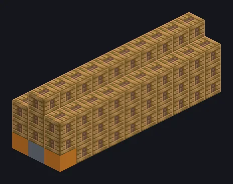

---
tags:
  - Catálogo de multiblocos
---

# Large Steam Circuit Assembler

<!-- Página gerada a partir do código do mod; a estrutura é a menor variante. -->

{ loading=lazy }

| | |
|---|---|
| **Tipos de receita** | Circuit Assembler |
| **Tamanho** | 3 × 4 × 10 |
| **Blocos** | 100 |

## Descrição

Circuitos soldados à mão, só que sem as mãos. Uma linha de circuitos da era do vapor focada em barramento de entrada para travar nessa saída.

- Tipo de Máquina: Montadora de Circuitos
- um circuito: coloque 16 circuitos gravados no
- Modo Multiplicar: saída 2x
- Alta pressão: 2x velocidade, 2x vapor
- Paralelos: até 4
- O Modo Multiplicar deixa as receitas 4x mais lentas

## Estrutura

| Bloco | Qtd. |
|---|---:|
| Steam Machine Casing | 80 |
| Bronze Pipe Casing | 8 |
| Bloco de Montagem a Vapor | 8 |
| Hatch de Entrada de Vapor Wireless | 1 |
| Barramento de Saída a Vapor com Boost de Saída | 1 |
| Large Steam Circuit Assembler | 1 |
| Steam Input Bus | 1 |

<small>Página gerada a partir do código do mod; a estrutura é a menor variante.</small>
