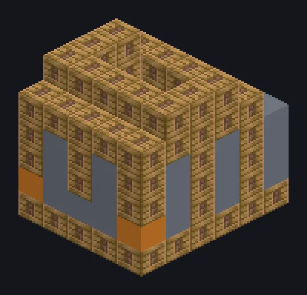

---
tags:
  - Catálogo de multiblocos
---

# Grande Macerador a Vapor

<!-- Página gerada a partir do código do mod; a estrutura é a menor variante. -->

{ loading=lazy }

| | |
|---|---|
| **Tipos de receita** | Macerator |
| **Tamanho** | 5 × 6 × 7 |
| **Blocos** | 154 |

[Guia completo →](../steam/large-steam-crusher.md)

## Descrição

Pedra entra, cascalho sai. Ninguém pergunta do barulho. Um salão de trituração a vapor que mói minérios e pedra em lotes enormes.

- Tipo de Máquina: Macerador
- Velocidade 2x maior que a singleblock
- Alta pressão: 2x velocidade, 2x vapor
- Paralelos: até 128

## Estrutura

| Bloco | Qtd. |
|---|---:|
| Steam Machine Casing | 98 |
| Bronze Frame | 24 |
| Bronze Gearbox Casing | 14 |
| Bronze Pipe Casing | 14 |
| Barramento Grande de Saída a Vapor | 1 |
| Grande Macerador a Vapor | 1 |
| Steam Input Bus | 1 |
| Hatch de Entrada de Vapor Wireless | 1 |

<small>Página gerada a partir do código do mod; a estrutura é a menor variante.</small>
