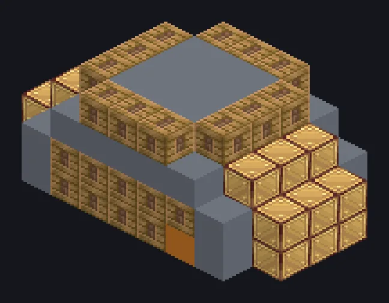

---
tags:
  - 蒸汽与原始
---

# 大型蒸汽切割机

<!-- 根据模组代码生成;所示结构为最小形态。 -->

*量两次，切十六次。*

{ loading=lazy }

| | |
|---|---|
| **机器类型** | 切割机 |
| **分类** | 蒸汽与原始 |
| **配方类型** | 切割机 |
| **尺寸** | 9 × 4 × 5 |
| **方块数** | 124 |
| **来源** | GT: Not Leisure |

## 说明

一台用于批量生产板、螺栓和薄片的蒸汽切割机。

- 速度为单方块的2倍
- 高压：2倍速度，2倍蒸汽
- 并行：最高16

## 结构

| 方块 | 数量 |
|---|---:|
| 蒸汽机械方块 | 45 |
| 青铜框架 | 37 |
| 工业蒸汽机械方块 | 28 |
| 青铜管道方块 | 7 |
| Block of Diamond | 3 |
| 青铜齿轮箱机械方块 | 2 |
| 大型蒸汽切割机 | 1 |
| 蒸汽输入仓 | 1 |

<small>根据模组代码生成；所示结构为最小形态。</small>
