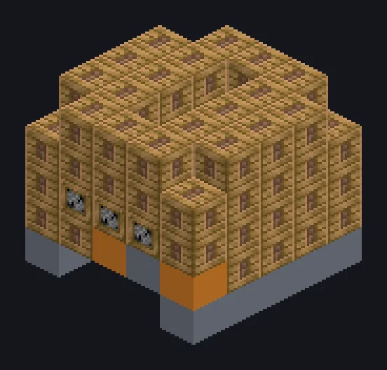

---
tags:
  - Vapor e primitivos
---

# Grande Extrator a Vapor

<!-- Gerada a partir do código do mod; a estrutura mostrada é a menor variante. -->

*Espreme suco de coisas que nunca tiveram suco.*

{ loading=lazy }

| | |
|---|---|
| **Tipo de máquina** | Extrator |
| **Categoria** | Vapor e primitivos |
| **Tipos de receita** | Extractor |
| **Tamanho** | 5 × 5 × 5 |
| **Blocos** | 100 |
| **Origem** | GT: Not Leisure |

## Descrição

Um extrator a vapor compacto de estrutura compartilhada para extração em massa.

- Velocidade ~1,75x maior que a singleblock
- Alta pressão: 2x velocidade, 2x vapor
- Paralelos: até 48

## Estrutura

| Bloco | Qtd. |
|---|---:|
| Steam Machine Casing | 62 |
| Bronze Gearbox Casing | 15 |
| Bronze Frame | 13 |
| Bronze Pipe Casing | 6 |
| Grande Extrator a Vapor | 1 |
| Steam Output Bus | 1 |
| Steam Input Bus | 1 |
| Hatch de Entrada de Vapor Wireless | 1 |

<small>Gerada a partir do código do mod; a estrutura mostrada é a menor variante.</small>
