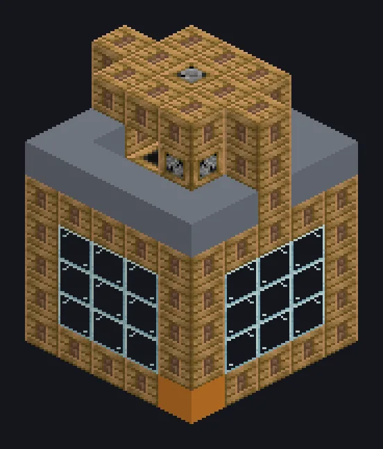

---
tags:
  - 蒸汽与原始
---

# 大型蒸汽压模器

<!-- 根据模组代码生成;所示结构为最小形态。 -->

*像面条机，只不过做的是金属和悔恨。*

{ loading=lazy }

| | |
|---|---|
| **机器类型** | 压模器 |
| **分类** | 蒸汽与原始 |
| **配方类型** | 压模器 |
| **尺寸** | 5 × 8 × 5 |
| **方块数** | 156 |
| **来源** | GT: Not Leisure |

## 说明

一台蒸汽压模器，批量将金属挤过成型模头。

- 速度为单方块的2倍
- 高压：2倍速度，2倍蒸汽
- 并行：最高16

## 结构

| 方块 | 数量 |
|---|---:|
| 蒸汽机械方块 | 65 |
| Glass | 36 |
| Block of Iron | 25 |
| 青铜框架 | 14 |
| 青铜管道方块 | 10 |
| 青铜齿轮箱机械方块 | 4 |
| 大型蒸汽压模器 | 1 |
| 蒸汽输入仓 | 1 |

<small>根据模组代码生成；所示结构为最小形态。</small>
