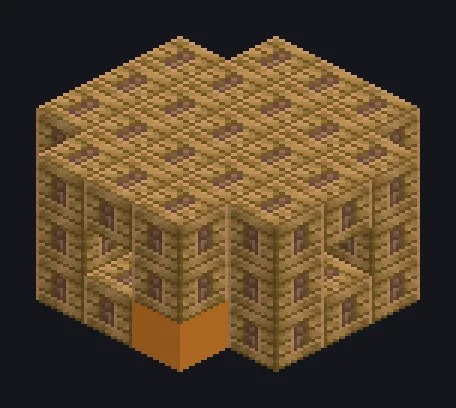

---
tags:
  - Steam and primitive
---

# Large Steam Forming Press

<!-- Generated from the mod code; the structure shown is the smallest variant. -->

*Pressing matters, one stamp at a time.*

{ loading=lazy }

| | |
|---|---|
| **Machine type** | Forming Press |
| **Category** | Steam and primitive |
| **Recipe types** | Forming Press |
| **Size** | 5 × 3 × 5 |
| **Blocks** | 58 |
| **Origin** | GT: Not Leisure |

## Description

A steam forming press for molds, lenses and pressed parts in bulk.

- 2.5x speed vs. singleblock
- High pressure: 2x speed, 2x steam
- Parallel: up to 32

## Structure

| Block | Qty |
|---|---:|
| Steam Machine Casing | 48 |
| Bronze Gearbox Casing | 4 |
| Bronze Pipe Casing | 4 |
| Large Steam Forming Press | 1 |
| Wireless Steam Input Hatch | 1 |

<small>Generated from the mod code; the structure shown is the smallest variant.</small>
