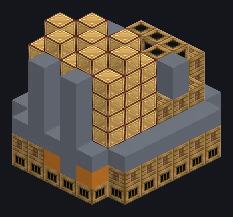

---
tags:
  - Catálogo de multiblocos
---

# Grande Fornalha a Vapor

<!-- Página gerada a partir do código do mod; a estrutura é a menor variante. -->

{ loading=lazy }

| | |
|---|---|
| **Tipos de receita** | Electric Furnace |
| **Tamanho** | 7 × 8 × 8 |
| **Blocos** | 260 |

[Guia completo →](../steam/large-steam-furnace.md)

## Descrição

Não tente assar biscoitos aqui dentro. Eles evaporam. Uma instalação industrial de fundição a vapor que cozinha estoques inteiros de uma vez.

- Tipo de Máquina: Fornalha
- Velocidade 10x maior que a singleblock
- Alta pressão: 2x velocidade, 2x vapor
- Paralelos: até 128

## Estrutura

| Bloco | Qtd. |
|---|---:|
| Casing Industrial a Vapor | 87 |
| Steam Machine Casing | 84 |
| Bronze Pipe Casing | 32 |
| Bronze Frame | 31 |
| Bronze Firebox Casing | 22 |
| Steam Output Bus | 1 |
| Grande Fornalha a Vapor | 1 |
| Barramento Grande de Entrada a Vapor | 1 |
| Hatch de Entrada de Vapor Wireless | 1 |

<small>Página gerada a partir do código do mod; a estrutura é a menor variante.</small>
