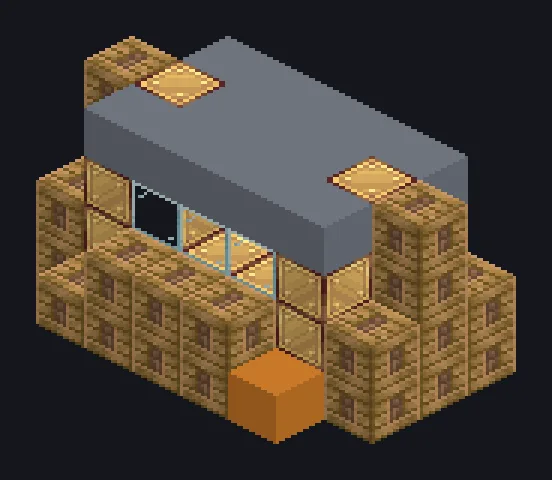

---
tags:
  - 蒸汽与原始
---

# 大型蒸汽车床

<!-- 根据模组代码生成;所示结构为最小形态。 -->

*早在电力流行之前就在车棒了。*

{ loading=lazy }

| | |
|---|---|
| **机器类型** | 车床 |
| **分类** | 蒸汽与原始 |
| **配方类型** | 车床 |
| **尺寸** | 7 × 4 × 5 |
| **方块数** | 89 |
| **来源** | GT: Not Leisure |

## 说明

一台蒸汽车床，用于批量车削棒和螺栓。

- 速度为单方块的2倍
- 高压：2倍速度，2倍蒸汽
- 并行：最高16

## 结构

| 方块 | 数量 |
|---|---:|
| 蒸汽机械方块 | 30 |
| 工业蒸汽机械方块 | 27 |
| 青铜框架 | 13 |
| 青铜管道方块 | 6 |
| Glass | 6 |
| Block of Iron | 3 |
| 青铜齿轮箱机械方块 | 2 |
| 大型蒸汽车床 | 1 |
| 蒸汽输入仓 | 1 |

<small>根据模组代码生成；所示结构为最小形态。</small>
