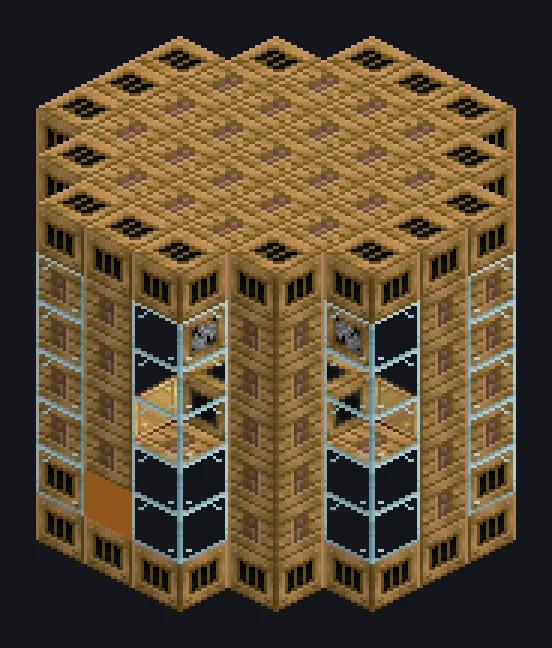

---
tags:
  - 蒸汽与原始
---

# 大型蒸汽搅拌机

<!-- 根据模组代码生成;所示结构为最小形态。 -->

*摇匀，不要搅拌。其实两样都做。*

{ loading=lazy }

| | |
|---|---|
| **机器类型** | 搅拌机 |
| **分类** | 蒸汽与原始 |
| **配方类型** | 搅拌机 |
| **尺寸** | 7 × 7 × 7 |
| **方块数** | 243 |
| **来源** | GT: Not Leisure |

## 说明

一个批量混合粉末和流体的蒸汽搅拌室。

- 速度为单方块的2倍
- 高压：2倍速度，2倍蒸汽
- 并行：最高64

## 结构

| 方块 | 数量 |
|---|---:|
| 蒸汽机械方块 | 80 |
| Glass | 40 |
| 工业蒸汽机械方块 | 40 |
| 青铜燃烧室 | 32 |
| 青铜齿轮箱机械方块 | 25 |
| 青铜管道方块 | 24 |
| 无线蒸汽输入仓 | 1 |
| 大型蒸汽搅拌机 | 1 |

<small>根据模组代码生成；所示结构为最小形态。</small>
