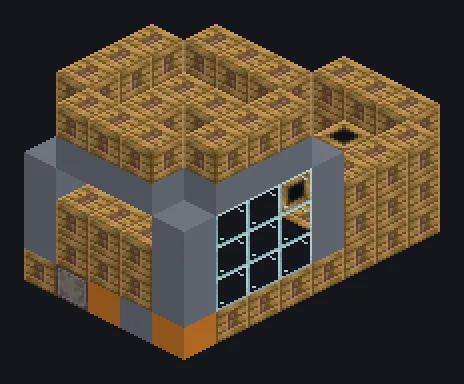

---
tags:
  - Steam and primitive
---

# Large Steam Ore Washer

<!-- Generated from the mod code; the structure shown is the smallest variant. -->

*The cleanest ores in the Bronze Age. Mom would be proud.*

{ loading=lazy }

| | |
|---|---|
| **Machine type** | Ore Washer |
| **Category** | Steam and primitive |
| **Recipe types** | Ore Washer |
| **Size** | 5 × 6 × 9 |
| **Blocks** | 164 |
| **Origin** | GT: Not Leisure |

## Description

A large steam washing basin that rinses crushed ores by the hundreds.

- 5x speed vs. singleblock
- High pressure: 2x speed, 2x steam
- Parallel: up to 96

## Structure

| Block | Qty |
|---|---:|
| Steam Machine Casing | 101 |
| Bronze Frame | 24 |
| Glass | 18 |
| Bronze Pipe Casing | 16 |
| ULV Input Hatch | 1 |
| Output Boost Steam Output Bus | 1 |
| Large Steam Ore Washer | 1 |
| Steam Input Bus | 1 |
| Steam Input Hatch | 1 |

<small>Generated from the mod code; the structure shown is the smallest variant.</small>
