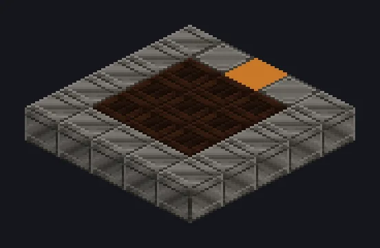

---
tags:
  - Catálogo de multiblocos
---

# Large Steam Solar Boiler

<!-- Página gerada a partir do código do mod; a estrutura é a menor variante. -->

{ loading=lazy }

| | |
|---|---|
| **Tipos de receita** | Nenhum |
| **Tamanho** | 5 × 1 × 5 |
| **Blocos** | 25 |

[Guia completo →](../steam/large-steam-solar-boiler.md)

## Descrição

Vapor grátis, cortesia de uma estrela bem grande. Um campo solar de vapor expansível feito de células de ebulição solar.

- Tipo de Máquina: Caldeira Solar
- A produção de vapor cresce com as células ao sol
- Cresce até 63 blocos para o lado, 125 para trás
- As células precisam ficar ao sol para contar

## Estrutura

| Bloco | Qtd. |
|---|---:|
| Solid Steel Machine Casing | 13 |
| Solar Boiling Cell | 9 |
| LV Input Hatch | 1 |
| Large Steam Solar Boiler | 1 |
| LV Output Hatch | 1 |

<small>Página gerada a partir do código do mod; a estrutura é a menor variante.</small>
