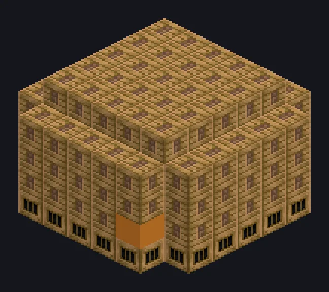

---
tags:
  - Vapor e primitivos
---

# Large Steam Thermal Centrifuge

<!-- Gerada a partir do código do mod; a estrutura mostrada é a menor variante. -->

*Girando e assando: o pior dia da vida do minério.*

{ loading=lazy }

| | |
|---|---|
| **Tipo de máquina** | Centrífuga Térmica |
| **Categoria** | Vapor e primitivos |
| **Tipos de receita** | Thermal Centrifuge |
| **Tamanho** | 7 × 5 × 7 |
| **Blocos** | 145 |
| **Origem** | GT: Not Leisure |

## Descrição

Uma centrífuga térmica aquecida por fornalha para processamento pesado de minério a vapor.

- Velocidade 2x maior que a singleblock
- Alta pressão: 2x velocidade, 2x vapor
- Paralelos: até 64

## Estrutura

| Bloco | Qtd. |
|---|---:|
| Steam Machine Casing | 95 |
| Bronze Firebox Casing | 33 |
| Bronze Frame | 12 |
| Bronze Pipe Casing | 3 |
| Large Steam Thermal Centrifuge | 1 |
| Hatch de Entrada de Vapor Wireless | 1 |

<small>Gerada a partir do código do mod; a estrutura mostrada é a menor variante.</small>
