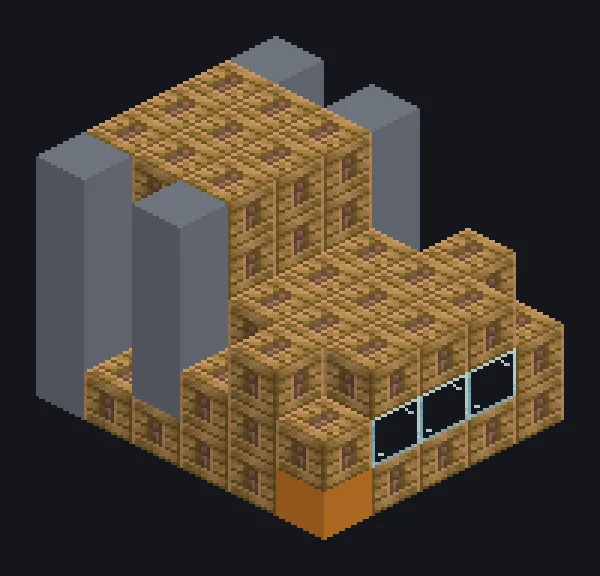

---
tags:
  - Multiblock catalog
---

# Large Steam Wiremill

<!-- Generated from the mod code; the structure shown is the smallest variant. -->

{ loading=lazy }

| | |
|---|---|
| **Recipe types** | Wiremill |
| **Size** | 6 × 5 × 5 |
| **Blocks** | 96 |

## Description

Thin is in. Very, very thin. A steam wiremill that draws ingots into wires in bulk.

- Machine Type: Wiremill
- 2x speed vs. singleblock
- High pressure: 2x speed, 2x steam
- Parallel: up to 16

## Structure

| Block | Qty |
|---|---:|
| Steam Machine Casing | 67 |
| Bronze Frame | 18 |
| Bronze Pipe Casing | 6 |
| Glass | 3 |
| Large Steam Wiremill | 1 |
| Wireless Steam Input Hatch | 1 |

<small>Generated from the mod code; the structure shown is the smallest variant.</small>
