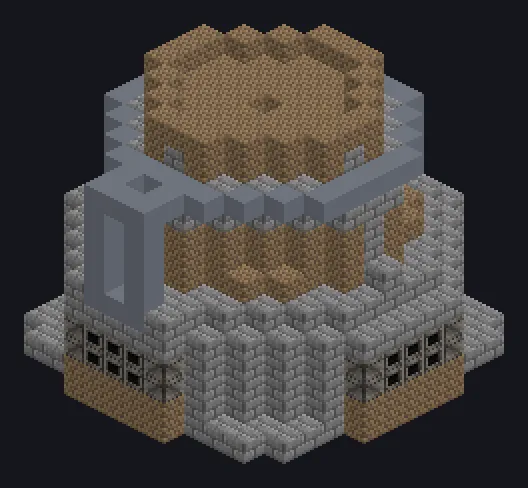

---
tags:
  - Catálogo de multiblocos
---

# Alto-Forno Um Salto Adiante

<!-- Página gerada a partir do código do mod; a estrutura é a menor variante. -->

{ loading=lazy }

| | |
|---|---|
| **Tipos de receita** | Primitive Blast Furnace |
| **Tamanho** | 15 × 13 × 15 |
| **Blocos** | 823 |

## Descrição

Um grande salto adiante na tecnologia primitiva. extra dobra os paralelos, mas deixa o ciclo mais lento.

- Tipo de Máquina: Alto-Forno Primitivo
- Um alto-forno primitivo que cresce: cada camada
- Os paralelos dobram a cada camada extra
- Paralelos máx.: 32.000
- Ciclo: 20 s +20 s por camada extra
- Estrutura mais alta = ciclo mais lento

## Estrutura

| Bloco | Qtd. |
|---|---:|
| Stone Bricks | 383 |
| Firebricks | 329 |
| Steel Frame | 68 |
| Steel Firebox Casing | 24 |
| Solid Steel Machine Casing | 16 |
| ULV Input Bus | 1 |
| ULV Output Bus | 1 |
| Alto-Forno Um Salto Adiante | 1 |

<small>Página gerada a partir do código do mod; a estrutura é a menor variante.</small>
