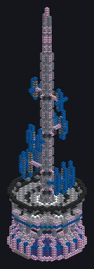

---
tags:
  - Catálogo de multiblocos
---

# Para-raios

<!-- Página gerada a partir do código do mod; a estrutura é a menor variante. -->

{ loading=lazy }

| | |
|---|---|
| **Tipos de receita** | Gerador de Arco |
| **Tamanho** | 23 × 99 × 23 |
| **Blocos** | 4.063 |

## Descrição

Chama raios de propósito. Os vizinhos têm perguntas. Canaliza descargas de arco para forjar o que o calor sozinho não faz, com raios na ponta.

- Tipo de Máquina: Gerador de Arco
- Thread Hatch: várias receitas ao mesmo tempo
- Aceita Laser Hatches
- Paralelos definidos pelo Parallel Hatch

## Estrutura

| Bloco | Qtd. |
|---|---:|
| Carcaça Mecânica de Lafium | 821 |
| Palladium Substation Casing | 623 |
| Tempered Glass | 432 |
| Stainless Steel Frame | 386 |
| Black Steel Frame | 332 |
| Carcaça Molecular | 290 |
| Carcaça de Irídio | 268 |
| Invólucro de Liga de Naquadah | 228 |
| Superconducting Coil Block | 204 |
| Fusion Glass | 148 |
| Bloco Mecânico de Isolamento Térmico de Cerâmica de Óxido de Magnésio | 80 |
| Hipernúcleo | 64 |
| White Lamp | 56 |
| Bobina Molecular | 48 |
| Bobina Supercondutora Aprimorada | 40 |
| Polished Deepslate Slab | 36 |
| ULV Output Hatch | 1 |
| ULV Input Hatch | 1 |
| ULV Output Bus | 1 |
| Para-raios | 1 |
| ULV Input Bus | 1 |
| Auto Maintenance Hatch | 1 |
| ULV Energy Hatch | 1 |

<small>Página gerada a partir do código do mod; a estrutura é a menor variante.</small>
