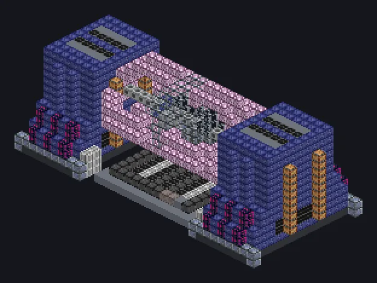

---
tags:
  - Multiblock catalog
---

# Magnetic Energy Reaction Furnace

<!-- Generated from the mod code; the structure shown is the smallest variant. -->

{ loading=lazy }

| | |
|---|---|
| **Recipe types** | Arc Furnace |
| **Size** | 33 × 14 × 15 |
| **Blocks** | 2,265 |

## Description

Smells like ozone. Fresh, but dangerous. Plasma arcs held by strong magnetic fields create and recycle matter at stellar heat.

- Machine Type: Arc Furnace
- Parallel 2x every 900K of coils
- Thread Hatch: several recipes at once
- Uses the Parallel Hatch limit if higher

## Structure

| Block | Qty |
|---|---:|
| Lafium Mechanical Casing | 886 |
| Fusion Glass | 236 |
| High Strength Concrete | 210 |
| Cupronickel Coil Block | 184 |
| Palladium Substation Casing | 176 |
| Electrolytic Cell | 105 |
| Nonconducting Casing | 99 |
| Transcendentally Amplified Magnetic Confinement Casing | 80 |
| Magnetic Neodymium Block | 80 |
| Magtech Casing | 48 |
| Neutronium Frame | 45 |
| Tungstensteel Turbine Casing | 44 |
| Empty Tier III Capacitor | 38 |
| Amprosium Pipe Casing | 19 |
| Restraint Device | 8 |
| Magnetic Energy Reaction Furnace | 1 |
| ULV Input Hatch | 1 |
| ULV Output Hatch | 1 |
| ULV Input Bus | 1 |
| ULV Output Bus | 1 |
| ULV Energy Hatch | 1 |
| Cleaning Maintenance Hatch | 1 |

<small>Generated from the mod code; the structure shown is the smallest variant.</small>
