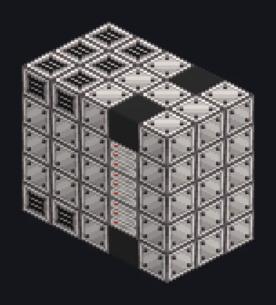

---
tags:
  - 能量、AE2 与算力
---

# ME存储器

<!-- 根据模组代码生成;所示结构为最小形态。 -->

*字节多到你永远用不完。大概吧。*

{ loading=lazy }

| | |
|---|---|
| **机器类型** | ME存储 |
| **分类** | 能量、AE2 与算力 |
| **配方类型** | 无 |
| **尺寸** | 5 × 5 × 3 |
| **方块数** | 75 |
| **来源** | GregTech Odyssey |

## 说明

核心切片以增加存储段。

- 一个可扩展的ME存储多方块：重复
- 随结构增大
- 最多128个存储段
- 需要恰好一个ME存储访问仓、
- 大型存储访问仓或输入输出端口仓

## 结构

| 方块 | 数量 |
|---|---:|
| 计算机外壳 | 45 |
| 计算机散热口 | 12 |
| T1矩阵存储模块 | 6 |
| 黑色ABS塑料机械外壳 | 4 |
| 高能机械方块 | 3 |
| 氧化锂陶瓷防热抗震机械方块 | 3 |
| ME大型存储访问仓 | 1 |
| ME存储器 | 1 |

<small>根据模组代码生成；所示结构为最小形态。</small>
