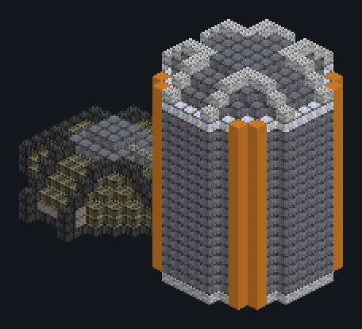

---
tags:
  - Multiblock catalog
---

# Mega Brewer

<!-- Generated from the mod code; the structure shown is the smallest variant. -->

{ loading=lazy }

| | |
|---|---|
| **Recipe types** | Brewery, Fermenter |
| **Size** | 28 × 22 × 15 |
| **Blocks** | 2,390 |

## Description

Thousand-ton brewing. The whole workshop smells great. Brews and ferments at industrial scale in giant temperature-controlled tanks.

- Machine Type: Brewery, Fermenter
- Parallel 2x every 900K of coils
- Thread Hatch: several recipes at once
- Uses the Parallel Hatch limit if higher

## Structure

| Block | Qty |
|---|---:|
| Antifreeze Heatproof Machine Casing | 1,065 |
| Cupronickel Coil Block | 216 |
| Corrosion Proof Casing | 189 |
| Chemically Inert PTFE Machine Casing | 185 |
| Dimension Injection Casing | 184 |
| Iridium Casing | 165 |
| Hastelloy N Frame | 152 |
| Amprosium Pipe Casing | 83 |
| UEV Hermetic Casing | 72 |
| Containment Field Generator | 60 |
| Chemical Corrosion Resistant Pipe Casing | 12 |
| ULV Input Hatch | 1 |
| ULV Output Bus | 1 |
| Mega Brewer | 1 |
| ULV Input Bus | 1 |
| Auto Maintenance Hatch | 1 |
| ULV Energy Hatch | 1 |
| ULV Output Hatch | 1 |

<small>Generated from the mod code; the structure shown is the smallest variant.</small>
