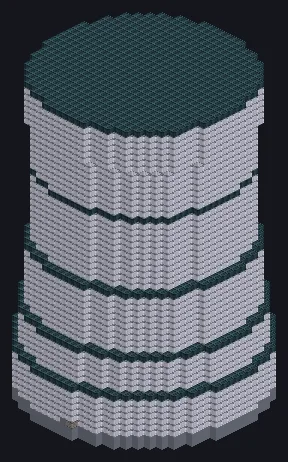

---
tags:
  - Multiblock catalog
---

# Mega Distillery

<!-- Generated from the mod code; the structure shown is the smallest variant. -->

{ loading=lazy }

| | |
|---|---|
| **Recipe types** | Distillery, Distillation Tower, Evaporation |
| **Size** | 31 × 52 × 31 |
| **Blocks** | 9,485 |

## Description

Every fraction of the barrel, accounted for. Runs Distillery, Distillation Tower and Evaporation recipes at megafactory scale.

- Machine Type: Distillery, Distillation
- Distillation outputs go to any fluid hatch
- Thread Hatch: several recipes at once
- Parallel set by the Parallel Hatch

## Structure

| Block | Qty |
|---|---:|
| Clean Stainless Steel Casing | 5,351 |
| Watertight Casing | 3,092 |
| Trinium Frame | 544 |
| UEV Hermetic Casing | 292 |
| Tritanium Coil Block | 196 |
| ULV Output Hatch | 1 |
| ULV Input Hatch | 1 |
| ULV Output Bus | 1 |
| Mega Distillery | 1 |
| Auto Maintenance Hatch | 1 |
| ULV Energy Hatch | 1 |
| ULV Input Bus | 1 |
| ZPM Thread Hatch | 1 |
| IV 4,096A Laser Target Hatch | 1 |
| Elite Parallel Control Hatch | 1 |

<small>Generated from the mod code; the structure shown is the smallest variant.</small>
