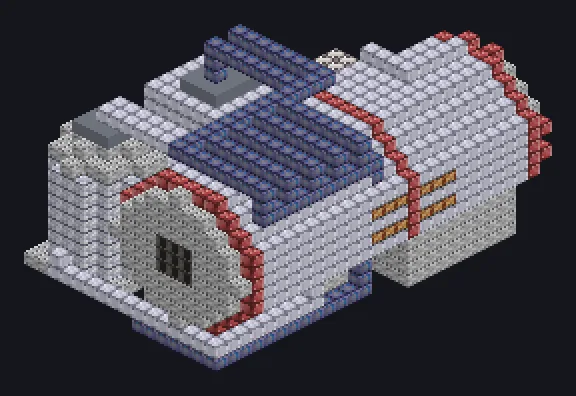

---
tags:
  - Electric processing
---

# Mega Vacuum Drying Furnace

<!-- Generated from the mod code; the structure shown is the smallest variant. -->

*Zero oxidation, zero contamination, zero patience needed.*

{ loading=lazy }

| | |
|---|---|
| **Machine type** | Vacuum Drying |
| **Category** | Electric processing |
| **Recipe types** | Vacuum Drying |
| **Size** | 19 × 14 × 27 |
| **Blocks** | 2,691 |
| **Origin** | GregTech Odyssey |

## Description

Dries ore foams into pure dusts in vacuum at megafactory scale.

- Parallel 2x every 900K of coils
- Thread Hatch: several recipes at once
- Uses the Parallel Hatch limit if higher
- Coils must meet the recipe temperature

## Structure

| Block | Qty |
|---|---:|
| Clean Stainless Steel Casing | 1,172 |
| Iridium Casing | 584 |
| Cupronickel Coil Block | 224 |
| Pressure Containment Casing | 169 |
| Red Steel Casing | 168 |
| High Pressure Pipe Casing | 132 |
| Tungstensteel Pipe Casing | 88 |
| Computer Casing | 60 |
| Tungsten Frame | 23 |
| Hermetic Casing VI | 20 |
| High Power Casing | 18 |
| Filter Casing | 9 |
| Assembly Line Grating | 9 |
| Computer Heat Vent | 6 |
| Tungstensteel Gearbox Casing | 3 |
| ULV Energy Hatch | 1 |
| ULV Input Hatch | 1 |
| Cleaning Maintenance Hatch | 1 |
| Mega Vacuum Drying Furnace | 1 |
| ULV Output Bus | 1 |
| ULV Output Hatch | 1 |

<small>Generated from the mod code; the structure shown is the smallest variant.</small>
