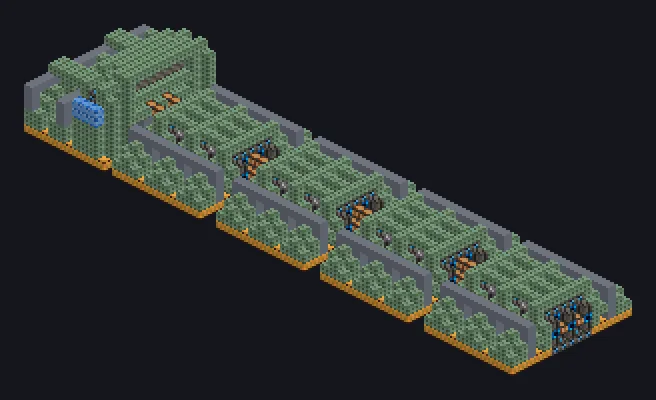

---
tags:
  - Multiblock catalog
---

# Mega Wiremill

<!-- Generated from the mod code; the structure shown is the smallest variant. -->

{ loading=lazy }

| | |
|---|---|
| **Recipe types** | Wiremill |
| **Size** | 61 × 10 × 15 |
| **Blocks** | 3,163 |

## Description

From bulky ingots to hair-thin perfect wires. Draws metal into perfect wires under thousands of tons of pressure.

- Machine Type: Wiremill
- Parallel 2x every 900K of coils
- Thread Hatch: several recipes at once
- Uses the Parallel Hatch limit if higher

## Structure

| Block | Qty |
|---|---:|
| Heat Proof Invar Machine Casing | 1,117 |
| High Strength Support Mechanical Casing | 702 |
| Tungsten Steel Frame | 313 |
| Assembly Line Grating | 283 |
| Cupronickel Coil Block | 180 |
| Hollow Casing | 152 |
| Advanced Assembly Line Unit | 116 |
| Assembly Line Casing | 102 |
| High Strength Support Spindle | 80 |
| Pikyonium Machine Casing | 74 |
| Amprosium Gearbox | 39 |
| ULV Energy Hatch | 1 |
| ULV Output Bus | 1 |
| Cleaning Maintenance Hatch | 1 |
| Mega Wiremill | 1 |
| ULV Input Bus | 1 |

<small>Generated from the mod code; the structure shown is the smallest variant.</small>
