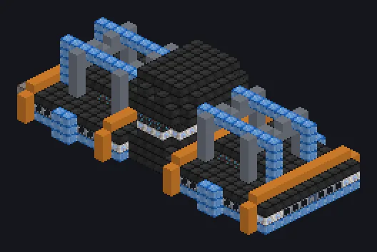

---
tags:
  - Processamento elétrico
---

# Fábrica de Montagem de Circuitos por Nanites

<!-- Gerada a partir do código do mod; a estrutura mostrada é a menor variante. -->

*Sem rugido de fornalha, sem braço robótico. Só nanitas.*

{ loading=lazy }

| | |
|---|---|
| **Tipo de máquina** | Montadora de Circuitos |
| **Categoria** | Processamento elétrico |
| **Tipos de receita** | Circuit Assembler |
| **Tamanho** | 29 × 10 × 13 |
| **Blocos** | 1.291 |
| **Origem** | GregTech Odyssey |

## Descrição

Roda receitas de Montadora de Circuitos em escala de megafábrica.

- Thread Hatch: várias receitas ao mesmo tempo
- Aceita Laser Hatches
- Paralelos definidos pelo Parallel Hatch

## Estrutura

| Bloco | Qtd. |
|---|---:|
| Invólucro de Liga de Naquadah | 578 |
| Carcaça de Máquina de Pikyônio | 372 |
| Hastelloy N Frame | 68 |
| Hastelloy X Frame | 68 |
| Invólucro de Injeção Dimensional | 44 |
| Carcaça de Tubo de Amprósio | 43 |
| Fusion Glass | 36 |
| Trinium Frame | 36 |
| Carcaça da Linha de Montagem de Circuitos | 22 |
| Hipernúcleo | 18 |
| ULV Input Hatch | 1 |
| ULV Output Bus | 1 |
| ULV Input Bus | 1 |
| Cleaning Maintenance Hatch | 1 |
| ULV Energy Hatch | 1 |
| Fábrica de Montagem de Circuitos por Nanites | 1 |

<small>Gerada a partir do código do mod; a estrutura mostrada é a menor variante.</small>
