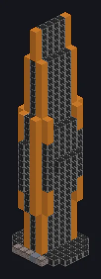

---
tags:
  - 终局系统
---

# 纳米锻炉

<!-- 根据模组代码生成;所示结构为最小形态。 -->

*纳米机器人，孩子。数十亿个。*

{ loading=lazy }

| | |
|---|---|
| **机器类型** | 纳米机器人制造机 |
| **分类** | 终局系统 |
| **配方类型** | 纳米锻炉 |
| **尺寸** | 9 × 38 × 10 |
| **方块数** | 698 |
| **来源** | GT: New Horizons |

## 说明

以惊人的电力制造纳米机器人；任意输入总线中的纳米机器人决定等级。

- 低等级配方无损超频
- 决定等级的纳米机器人永不消耗
- 碳T1，中子素T2，超越T3
- 磁物质T4：熔融磁物质提供并行
- 将等级纳米机器人放在输入总线中
- 每个等级都需要结构变化

## 结构

| 方块 | 数量 |
|---|---:|
| 辐射硅岩合金外壳 | 522 |
| 恒星合金框架 | 170 |
| ULV输出总线 | 1 |
| ULV输入仓 | 1 |
| 纳米锻炉 | 1 |
| ULV输入总线 | 1 |
| 超净维护仓 | 1 |
| ULV能源仓 | 1 |

<small>根据模组代码生成；所示结构为最小形态。</small>
