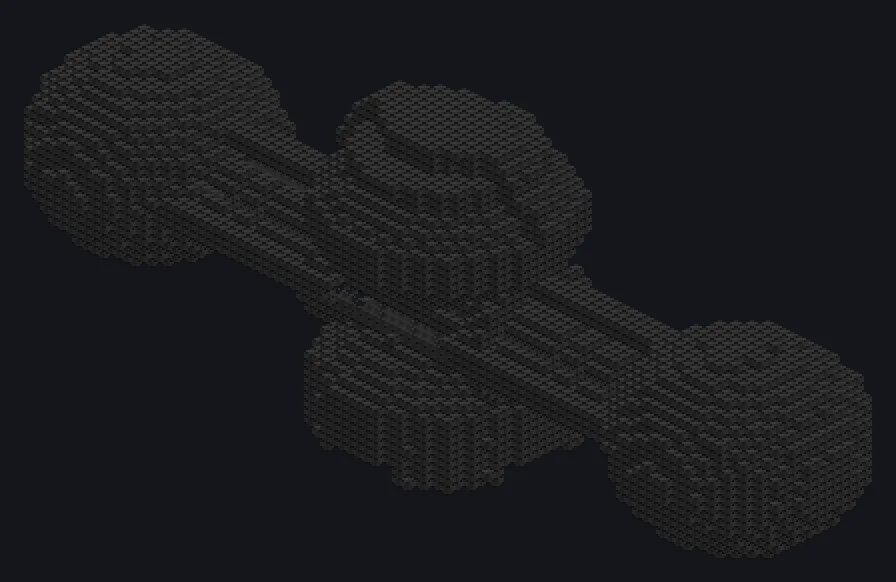

---
tags:
  - 发电
---

# 硅岩超能反应堆

<!-- 根据模组代码生成;所示结构为最小形态。 -->

*瓶中四颗太阳。请勿摇晃。*

{ loading=lazy }

| | |
|---|---|
| **机器类型** | 发电机 |
| **分类** | 发电 |
| **配方类型** | 硅岩超能反应堆 |
| **尺寸** | 96 × 38 × 24 |
| **方块数** | 12,269 |
| **来源** | GTNA 原创 |

## 说明

与大型硅岩反应堆相同的硅岩燃料。

- 最强的硅岩反应堆：在 UEV 燃烧
- 动力仓或激光源仓
- 仓室安装在控制器周围的环上
- 燃料 + 氢气：8,388,608 EU/t，每 mB 产能 4 倍
- 氧等离子体增幅：8x 并行
- 氮等离子体增幅：16x 并行
- 每次增幅运行消耗一次增幅等离子体

## 结构

| 方块 | 数量 |
|---|---:|
| 超能机械方块 | 9,666 |
| 硅岩合金框架 | 1,300 |
| 硅岩强化硼玻璃 | 1,298 |
| ULV输入仓 | 2 |
| 超净维护仓 | 1 |
| 硅岩超能反应堆 | 1 |
| ULV动力仓 | 1 |

<small>根据模组代码生成；所示结构为最小形态。</small>
