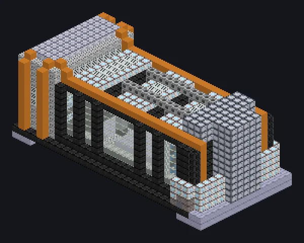

---
tags:
  - Multiblock catalog
---

# Neutronium Wire Cutting

<!-- Generated from the mod code; the structure shown is the smallest variant. -->

{ loading=lazy }

| | |
|---|---|
| **Recipe types** | Cutter |
| **Size** | 31 × 14 × 15 |
| **Blocks** | 2,824 |

## Description

Neutron star matter cuts like butter. Earth stuff? Air. Cuts with neutron-degenerate threads at atomic precision.

- Machine Type: Cutter
- Thread Hatch: several recipes at once
- Accepts Laser Hatches
- Parallel set by the Parallel Hatch

## Structure

| Block | Qty |
|---|---:|
| Naquadah Reinforced Plant Casing | 1,033 |
| Tempered Glass | 324 |
| Iridium Casing | 256 |
| Stainless Turbine Casing | 216 |
| High Pressure Resistant Casing | 188 |
| High Power Casing | 154 |
| Hastelloy N Frame | 116 |
| Amprosium Gearbox | 112 |
| Pressure Containment Casing | 88 |
| Amprosium Active Casing | 80 |
| Filter Casing | 70 |
| Precision Processing Mechanical Casing | 38 |
| Neutronium Frame | 38 |
| Amprosium Pipe Casing | 38 |
| Containment Field Generator | 25 |
| Heat Vent | 18 |
| Extreme Density Casing | 16 |
| Fusion Glass | 8 |
| ULV Input Bus | 1 |
| Cleaning Maintenance Hatch | 1 |
| Neutronium Wire Cutting | 1 |
| ULV Input Hatch | 1 |
| ULV Energy Hatch | 1 |
| ULV Output Bus | 1 |

<small>Generated from the mod code; the structure shown is the smallest variant.</small>
