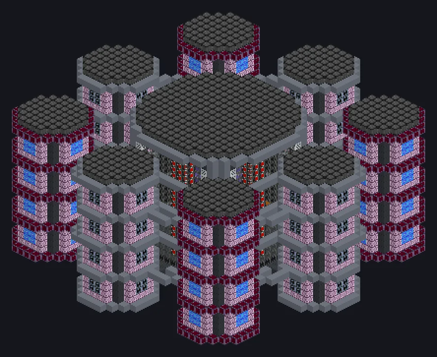

---
tags:
  - Energia, AE2 e computação
---

# Nexus ME Hypercore

<!-- Gerada a partir do código do mod; a estrutura mostrada é a menor variante. -->

*Roda Crysis? Ele fabrica o Crysis.*

{ loading=lazy }

| | |
|---|---|
| **Tipo de máquina** | Computador de Crafting ME |
| **Categoria** | Energia, AE2 e computação |
| **Tipos de receita** | Nenhum |
| **Tamanho** | 44 × 22 × 44 |
| **Blocos** | 7.736 |
| **Origem** | — |

## Descrição

Uma rede de computadores ME de 44x22x44 em volta de um núcleo de vidro laminado; cada módulo vira parte de uma CPU de crafting compartilhada.

- Encha tudo com tier IV: Modo Transcendente
- Transcendente: armazenamento e CPUs ilimitados
- Núcleo: até 320 módulos ou Crafting Units do AE2
- Threads por módulo: 4 / 16 / 128 / 1.024
- Precisa de exatamente uma Crafting CPU Interface

## Estrutura

| Bloco | Qtd. |
|---|---:|
| Concreto de Alta Resistência | 1.752 |
| Palladium Substation Casing | 1.536 |
| Laminated Glass | 798 |
| Nonconducting Casing | 692 |
| Stainless Steel Frame | 616 |
| Laser-Safe Engraving Casing | 480 |
| Black Steel Frame | 400 |
| Módulo de Crafting Matrix T1 | 320 |
| Molybdenum Disilicide Coil Block | 280 |
| Extreme Engine Intake Casing | 256 |
| Bloco Mecânico Cerâmico de Óxido de Cobalto Condutor Térmico de Alta Resistência | 256 |
| High Power Casing | 240 |
| Filter Casing | 108 |
| Interface de CPU de Crafting | 1 |
| Nexus ME Hypercore | 1 |

<small>Gerada a partir do código do mod; a estrutura mostrada é a menor variante.</small>
