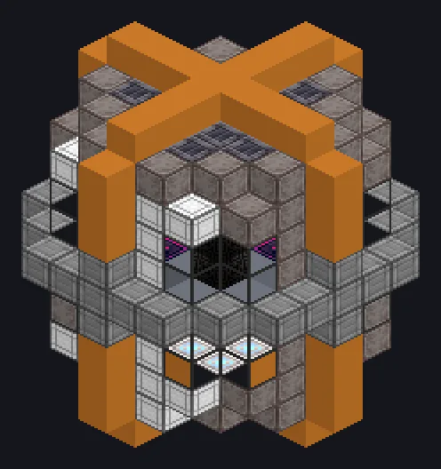

---
tags:
  - Energia, AE2 e computação
---

# Forja de Montagem Nexus

<!-- Gerada a partir do código do mod; a estrutura mostrada é a menor variante. -->

*Ingredientes? Para onde vamos, não precisamos de ingredientes.*

{ loading=lazy }

| | |
|---|---|
| **Tipo de máquina** | Crafting em Massa do AE2 |
| **Categoria** | Energia, AE2 e computação |
| **Tipos de receita** | Nenhum |
| **Tamanho** | 9 × 11 × 9 |
| **Blocos** | 367 |
| **Origem** | GregTech Odyssey |

## Descrição

Uma forja do AE2 ultrarrápida que enfileira pedidos dos Nexus Craft Pattern Hatches e os fabrica em lotes gigantes.

- Toda saída na fila aparece de uma vez
- Pedidos na fila não usam ingredientes físicos
- Energia: 1 EU por item fabricado
- Os paralelos seguem a CPU de crafting do AE2

## Estrutura

| Bloco | Qtd. |
|---|---:|
| ULV Output Bus | 76 |
| Casing Mecanico de Hastelloy N Resistente a Oxidacao | 55 |
| Hastelloy N Frame | 50 |
| Vidro de Borossilicato de Naquadah | 40 |
| High Power Casing | 32 |
| Casing de Maquina de Processo | 24 |
| Casing Magtech | 20 |
| Bloco Mecanico Ceramico de Zirconia Resistente a Flexao | 20 |
| Assembly Control Casing | 18 |
| Casing de Controle de Compressor | 18 |
| Europium Frame | 8 |
| Casing de Densidade Extrema | 5 |
| Forja de Montagem Nexus | 1 |

<small>Gerada a partir do código do mod; a estrutura mostrada é a menor variante.</small>
