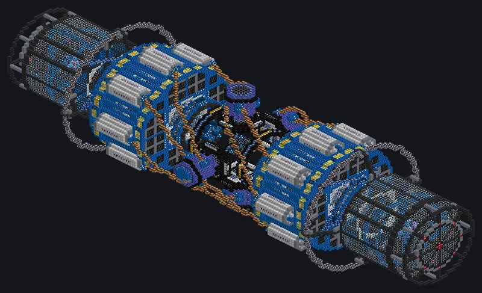

---
tags:
  - Electric processing
---

# Nyarlathoteps Tentacle

<!-- Generated from the mod code; the structure shown is the smallest variant. -->

*The Crawling Chaos builds your circuits. Don't ask its price.*

{ loading=lazy }

| | |
|---|---|
| **Machine type** | Assembly Line |
| **Category** | Electric processing |
| **Recipe types** | Assembly Line |
| **Size** | 165 × 48 × 49 |
| **Blocks** | 29,045 |
| **Origin** | GregTech Odyssey |

## Description

several recipes side by side.

- An Assembly Line with many arms: runs
- Thread Hatch: several recipes at once
- Parallel grows with the coil temperature
- Needs an Optical Data Reception Hatch

## Structure

| Block | Qty |
|---|---:|
| Fusion Glass | 6,344 |
| Molecular Casing | 5,009 |
| Sps Casing | 3,072 |
| Naquadah Alloy Casing | 2,280 |
| Electrolytic Cell | 1,384 |
| Block of Ruby | 1,088 |
| High Power Casing | 1,040 |
| Trinium Frame | 824 |
| Laser Casing | 800 |
| Extreme Density Casing | 728 |
| Electron Permeable Amprosium Coated Glass | 720 |
| Neutronium Frame | 685 |
| Quantum Glass | 652 |
| Spacetime Assembly Line Unit | 594 |
| Containment Field Generator | 542 |
| Amprosium Active Casing | 496 |
| Cupronickel Coil Block | 424 |
| Uruium Coil Block | 373 |
| Advanced Fusion Coil | 336 |
| Molecular Coil | 320 |
| Reinforced Spatial Structure Casing | 314 |
| Sterilizing Filter Casing | 256 |
| Spacetime Assembly Line Casing | 196 |
| Hyper Core | 154 |
| Laser Cooling Casing | 144 |
| Hollow Casing | 128 |
| Degenerate Rhenium Constrained Casing | 48 |
| Quark Pipe | 36 |
| Restraint Device | 34 |
| Dimensionally Transcendent Casing | 18 |
| ULV Input Bus | 1 |
| Optical Data Reception Hatch | 1 |
| Nyarlathoteps Tentacle | 1 |
| ULV Energy Hatch | 1 |
| ULV Input Hatch | 1 |
| ULV Output Bus | 1 |

<small>Generated from the mod code; the structure shown is the smallest variant.</small>
