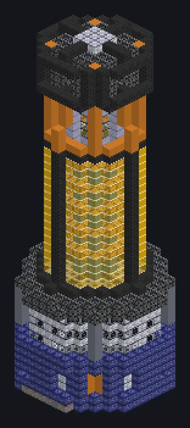

---
tags:
  - 电力加工
---

# 粒子流矩阵封装机

<!-- 根据模组代码生成;所示结构为最小形态。 -->

*现在连光子和声波都能装进罐子了。*

{ loading=lazy }

| | |
|---|---|
| **机器类型** | 装罐机 |
| **分类** | 电力加工 |
| **配方类型** | 装罐机 |
| **尺寸** | 15 × 46 × 15 |
| **方块数** | 3,141 |
| **来源** | GregTech Odyssey |

## 说明

以超大工厂规模将粒子流零损耗地注入容器。

- 线圈每900K并行翻倍
- 线程仓：同时运行多个配方
- 若并行仓上限更高则使用该上限

## 结构

| 方块 | 数量 |
|---|---:|
| 压力容器机械方块 | 672 |
| 电子渗透安普洛涂层玻璃 | 544 |
| 路菲恩机械方块 | 430 |
| 强化基座方块 | 337 |
| 耐压机械方块 | 317 |
| 安普洛管道方块 | 184 |
| 聚变玻璃 | 156 |
| 碳化凯金硅岩合金框架 | 127 |
| 白铜线圈方块 | 118 |
| 高速管道 | 76 |
| 电解器 | 68 |
| 高能耐压机械方块 | 61 |
| 多功能机械方块 | 24 |
| 黑钢框架 | 20 |
| ULV输出仓 | 1 |
| ULV输入仓 | 1 |
| ULV输出总线 | 1 |
| 粒子流矩阵封装机 | 1 |
| ULV输入总线 | 1 |
| 超净维护仓 | 1 |
| ULV能源仓 | 1 |

<small>根据模组代码生成；所示结构为最小形态。</small>
