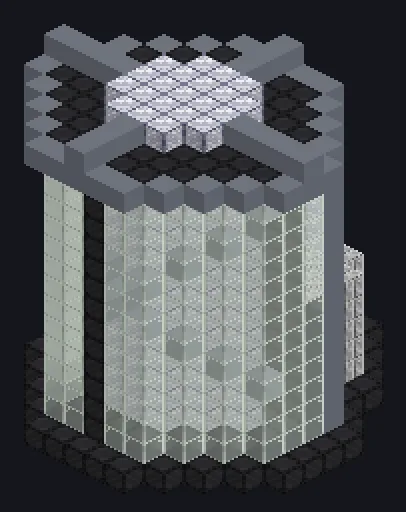

---
tags:
  - Multiblock catalog
---

# Pcb Factory

<!-- Generated from the mod code; the structure shown is the smallest variant. -->

{ loading=lazy }

| | |
|---|---|
| **Recipe types** | PCB Factory |
| **Size** | 13 × 16 × 14 |
| **Blocks** | 1,018 |

## Description

Prints boards by the thousand. The etchant smells like progress. Etches printed circuit boards in bulk; bigger structures unlock higher-tier boards.

- Machine Type: PCB Factory
- Three structure tiers (screwdriver on the controller)
- Accepts Laser Hatches
- Tier 1: up to 30,719 EU/t; tier 2: up to 491,519 EU/t
- Parallel set by the Parallel Hatch

## Structure

| Block | Qty |
|---|---:|
| Boron Carbide Radiation Resistant Casing | 330 |
| Pressure Containment Casing | 200 |
| Tempered Glass | 182 |
| Maraging Steel 300 Frame | 115 |
| Iridium Casing | 68 |
| Strontium Carbonate Ceramic Ray Absorbing Mechanical Cube | 32 |
| Europium Frame | 30 |
| Hermetic Casing VII | 29 |
| Magtech Casing | 14 |
| Pps Corrosion Resistant Mechanical Housing | 12 |
| Cleaning Maintenance Hatch | 1 |
| ULV Output Bus | 1 |
| Pcb Factory | 1 |
| ULV Energy Hatch | 1 |
| ULV Input Bus | 1 |
| ULV Input Hatch | 1 |

<small>Generated from the mod code; the structure shown is the smallest variant.</small>
