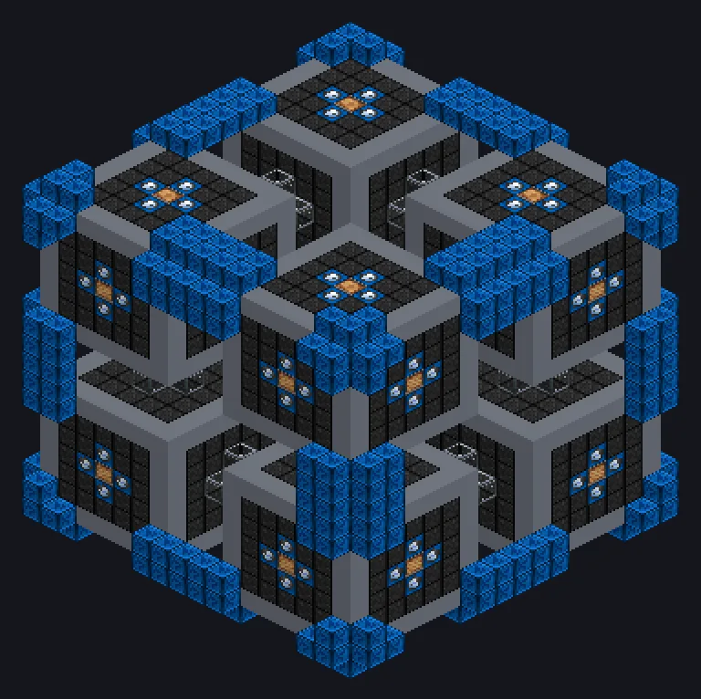

---
tags:
  - Multiblock catalog
---

# Phase Change Cube

<!-- Generated from the mod code; the structure shown is the smallest variant. -->

{ loading=lazy }

| | |
|---|---|
| **Recipe types** | Extractor, Fluid Solidifier |
| **Size** | 19 × 19 × 19 |
| **Blocks** | 2,547 |

## Description

Six faces, six phase changes. A Rubik's Cube for matter. Melts solids into fluids and freezes them back, reshaping states of matter.

- Machine Type: Extractor, Fluid Solidifier
- Parallel 2x every 900K of coils
- Thread Hatch: several recipes at once
- Uses the Parallel Hatch limit if higher

## Structure

| Block | Qty |
|---|---:|
| Naquadah Reinforced Plant Casing | 960 |
| Hastelloy C 276 Frame | 536 |
| Molecular Casing | 410 |
| Fusion Glass | 240 |
| Cupronickel Coil Block | 188 |
| Containment Field Generator | 96 |
| Amprosium Active Casing | 72 |
| High Power Casing | 38 |
| ULV Input Hatch | 1 |
| ULV Input Bus | 1 |
| Cleaning Maintenance Hatch | 1 |
| Phase Change Cube | 1 |
| ULV Energy Hatch | 1 |
| ULV Output Bus | 1 |
| ULV Output Hatch | 1 |

<small>Generated from the mod code; the structure shown is the smallest variant.</small>
