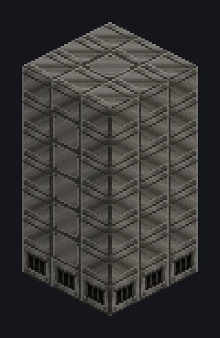

---
tags:
  - Catálogo de multiblocos
---

# Torre de Destilação Primitiva

<!-- Página gerada a partir do código do mod; a estrutura é a menor variante. -->

{ loading=lazy }

| | |
|---|---|
| **Tipos de receita** | Distillation Tower |
| **Tamanho** | 3 × 7 × 3 |
| **Blocos** | 58 |

## Descrição

Tecnologia de alambique, aumentada para petróleo. Uma torre de destilação primitiva a vapor para separar óleo e fluidos no início do jogo.

- Tipo de Máquina: Torre de Destilação
- Usa só 75% do vapor normal
- Uma saída de fluido por camada da torre

## Estrutura

| Bloco | Qtd. |
|---|---:|
| Solid Steel Machine Casing | 43 |
| Steel Firebox Casing | 7 |
| LV Output Hatch | 6 |
| Torre de Destilação Primitiva | 1 |
| Steam Input Hatch | 1 |

<small>Página gerada a partir do código do mod; a estrutura é a menor variante.</small>
