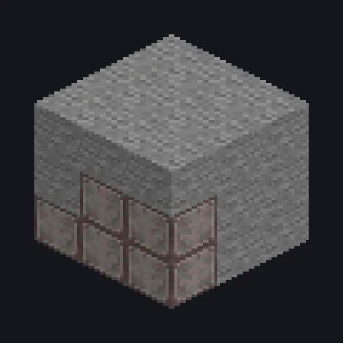

---
tags:
  - Steam and primitive
---

# Primitive Stone Furnace

<!-- Generated from the mod code; the structure shown is the smallest variant. -->

*Carved by hand, powered by nothing, judged by no one.*

{ loading=lazy }

| | |
|---|---|
| **Machine type** | Furnace |
| **Category** | Steam and primitive |
| **Recipe types** | Electric Furnace |
| **Size** | 3 × 3 × 3 |
| **Blocks** | 26 |
| **Origin** | GTLSupb |

## Description

A primitive furnace carved from stone that smelts like a furnace with no energy.

- Every recipe finishes in 1 tick
- Runs every furnace recipe at once, unlimited
- Parallel and threads: effectively unlimited

## Structure

| Block | Qty |
|---|---:|
| Stone | 20 |
| ULV Input Hatch | 1 |
| ULV Output Bus | 1 |
| Primitive Stone Furnace | 1 |
| ULV Energy Hatch | 1 |
| ULV Input Bus | 1 |
| ULV Output Hatch | 1 |

<small>Generated from the mod code; the structure shown is the smallest variant.</small>
