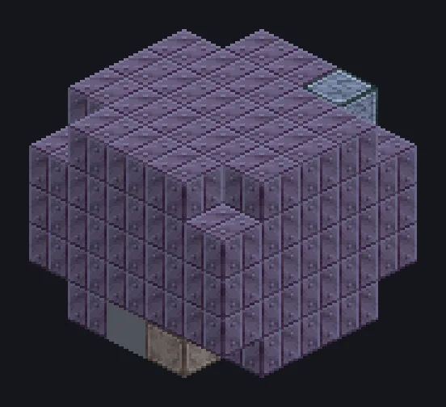

---
tags:
  - Electric processing
---

# Rare Earth Centrifugal

<!-- Generated from the mod code; the structure shown is the smallest variant. -->

*Spins rare earths until every lanthanide finds its jar.*

{ loading=lazy }

| | |
|---|---|
| **Machine type** | Centrifuge |
| **Category** | Electric processing |
| **Recipe types** | Rare Earth Centrifugal |
| **Size** | 5 × 5 × 5 |
| **Blocks** | 117 |
| **Origin** | GregTech Odyssey |

## Description

Splits rare earth concentrates into their elements in one spin.

- Builds in any direction
- Parallel set by the Parallel Hatch

## Structure

| Block | Qty |
|---|---:|
| Sturdy HSS-E Machine Casing | 82 |
| Tungstensteel Gearbox Casing | 24 |
| Amprosium Pipe Casing | 3 |
| ULV Output Hatch | 1 |
| ULV Input Hatch | 1 |
| Cleaning Maintenance Hatch | 1 |
| Rare Earth Centrifugal | 1 |
| ULV Output Bus | 1 |
| ULV Energy Hatch | 1 |
| ULV Input Bus | 1 |
| Elite Parallel Control Hatch | 1 |

<small>Generated from the mod code; the structure shown is the smallest variant.</small>
