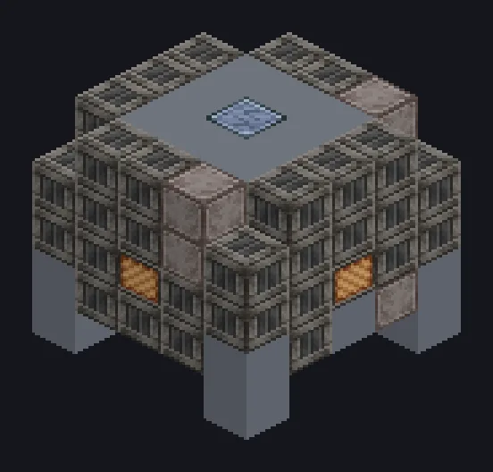

---
tags:
  - Catálogo de multiblocos
---

# Forno de Reação

<!-- Página gerada a partir do código do mod; a estrutura é a menor variante. -->

{ loading=lazy }

| | |
|---|---|
| **Tipos de receita** | Forno de Reação |
| **Tamanho** | 5 × 5 × 5 |
| **Blocos** | 100 |

## Descrição

Quente o bastante para a química acontecer, queira ou não. Faz reações de alta temperatura; as bobinas definem o calor, como num alto-forno.

- Tipo de Máquina: Forno de Reação
- O módulo libera Parallel e Accelerate Hatches
- A bobina precisa atingir a temperatura da receita

## Estrutura

| Bloco | Qtd. |
|---|---:|
| Solid Machine Casing | 54 |
| Steel Frame | 16 |
| Cupronickel Coil Block | 14 |
| Steel Pipe Casing | 8 |
| Forno de Reação | 1 |
| Muffler Hatch IV | 1 |
| ULV Input Bus | 1 |
| ULV Output Bus | 1 |
| ULV Input Hatch | 1 |
| ULV Output Hatch | 1 |
| ULV Energy Hatch | 1 |
| Cleaning Maintenance Hatch | 1 |

<small>Página gerada a partir do código do mod; a estrutura é a menor variante.</small>
