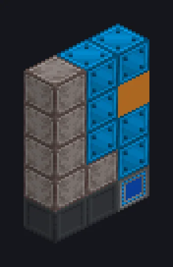

---
tags:
  - Catálogo de multiblocos
---

# Módulo de Coleta de Recursos

<!-- Página gerada a partir do código do mod; a estrutura é a menor variante. -->

{ loading=lazy }

| | |
|---|---|
| **Tipos de receita** | Mineração Espacial, Perfuração Espacial |
| **Tamanho** | 1 × 5 × 3 |
| **Blocos** | 15 |

## Descrição

Mineração de asteroides, sem o heroísmo de filme. Envia drones espaciais para minerar asteroides e coletar gases.

- Tipo de Máquina: Mineração Espacial, Perfuração Espacial
- Paralelos: 4^(MK do Power Module - 1)
- Só funciona com o Elevador Espacial rodando

## Estrutura

| Bloco | Qtd. |
|---|---:|
| Carcaça Mecânica de Elevador Espacial | 6 |
| Base de Módulo do Elevador Espacial | 2 |
| Conector de Módulo do Elevador Espacial | 1 |
| ULV Output Hatch | 1 |
| ULV Energy Hatch | 1 |
| ULV Input Bus | 1 |
| Módulo de Coleta de Recursos | 1 |
| ULV Output Bus | 1 |
| ULV Input Hatch | 1 |

<small>Página gerada a partir do código do mod; a estrutura é a menor variante.</small>
